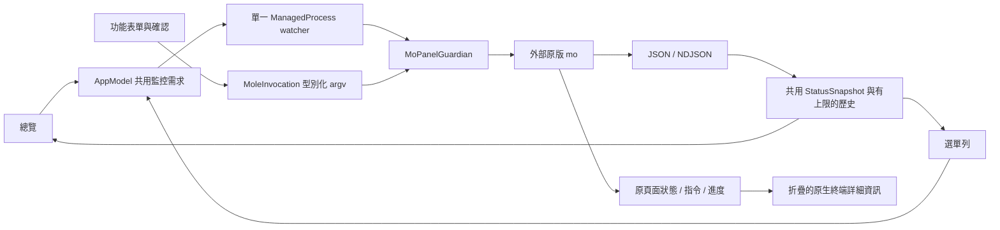

# 正式產品審查：第一批修復與接續點

日期：2026-10-24（Asia/Taipei）。工作分支：`codex/product-readiness-audit`；起點：`64b81eb`。本輪實作與有限驗證的程式提交：`9eb131721293cdf621161ef2052c3f8ca0c1e5cb`。

後續原生介面與監控面板的程式提交為 `4ae06698aa4be0e433ad473a7071f464f705b97d`，已通過本機完整建置與有限測試。最新來源、測試數、產物雜湊及適用範圍見 [native-interface-validation.json](audit-2026-10-24/native-interface-validation.json)。

**這是持續審查的第一批交付，不是正式版驗收完成報告。** 已完成來源與控制項的機器盤點，並人工追蹤監控、Mole 執行、程序輸出與主介面的相關路徑。全專案逐行人工審查、Stats 採樣模組整合、全部功能與長時間效能驗收尚未完成。歷史 CI 結果只適用於各自記載的舊 revision，不能套用到本分支。

## 來源與架構

| 來源 | 本輪實際讀取版本／位置 | 用途 |
|---|---|---|
| Mole 穩定版 | V1.62.0，`91a7bf44f96995361b10b5a0e9efae36a1490bf9` | 現有 adapter 的固定審查基準 |
| Mole main | `6f6dcbdc47aeec63ac4a09b235e583bd5f81a4c6` | 另讀 routing/help、status collection、CPU/GPU/Bluetooth/battery 實作；不是當作已發布穩定版 |
| Stats master | `7d3f70dcd6a07177d0a529a1b907021eef740158` | 讀取 CPU/GPU/RAM/Bluetooth reader 與其他模組採樣入口；目前沒有將其程式碼整合進 App |
| 官方 GUI | [公開文件](https://mole.fit/docs)、[CLI 與 App 差異](https://mole.fit/blog/mole-cli-vs-mac-app)、[Mole-App](https://github.com/tw93/Mole-App) | 公開能力比較；Mole-App 是文件與回報倉庫，不含商業 App 原始碼 |
| SwiftTerm | 1.20.0，`5d14406844143538cd8f8851d2d8a67c1fe443e5` | 唯一直接 GUI 套件；此次產生的 `Package.resolved` 固定實際解析結果 |

最新 release API 本輪實際回傳 V1.62.0，發布時間為 2026-10-21 UTC。完整來源記錄見 `audit-2026-10-24/upstream.json`。讀取上游使用獨立暫存 checkout，未改動 Mole、Stats 或使用者安裝的 CLI。



`AppModel` 仍是既有共用監控來源，本輪沒有另外啟動 Stats 採樣器。JSON 用於 status、analyze、history 與管線模式的 uninstall 清單。沒有項目級公開 API 的維護操作仍由原版 CLI 保留選取與確認，不能將其標成完整原生候選清單。

## 功能來源與目前能力

A＝Mole CLI；B＝MoPanel 原生；C＝Stats 程式碼；D＝額外產品功能；E＝其他元件／工具。下表是已追蹤的功能群；**不是逐個按鈕的驗收聲明**。完整控制項、程式位置、行號與檔案雜湊見 `audit-2026-10-24/inventory.json`，未逐項驗證者保留 pending。

| 功能／頁面 | 來源 | 實際指令或 API | 實作入口 | 狀態與本輪測試 |
|---|---|---|---|---|
| CLI 偵測／相容性 | A+B | version/help、安裝資源指紋 | `CLIProbe.inspect`、`AppModel.validatedInstallation`、`MoleCompatibility.assess` | 入口存在；未重新執行真實 CLI 全合約 |
| 系統清理 | A+B+E | `mo clean`、dry-run/debug/external/whitelist | `MaintenanceView` → `AppModel.request/startOperation` → Guardian；SwiftTerm | 同頁進度＋指令＋折疊詳細；項目選取仍為 CLI；新 UI 驗收待 CI |
| 軟體卸載 | A+B+E | `uninstall --list`、名稱、dry-run/with-data/permanent/debug | `loadApps`、`uninstall`、`InstalledAppSelection.validatedNames` | 原生清單＋官方最終確認；未在使用者 App 上測試刪除 |
| 系統最佳化 | A+B+E | `optimize`、dry-run/debug/whitelist | `MaintenanceView`、`request/startOperation` | 同頁執行；不是原生逐項工作結果 API |
| 磁碟分析 | A+B | `analyze --json [PATH]` | `AppModel.analyze`、`AnalyzeView`、`MoleJSON.decodeAnalyze` | 原生 treemap/導覽；真實大量掃描未測 |
| 系統總覽 | A+B | `status --json` / `status --watch --interval` / proc-cpu-* | `takeSnapshot/startMonitoring/acceptStatus` | 單一 watcher；需求／設定／低耗電純政策 probe 通過；睡眠實機未測 |
| 專案清理 | A+B+E | `purge`、dry-run/debug/paths/include-empty/yes | `MaintenanceView`、`MoPanelEditor`、`PurgePathsDocument` | 原生 options/paths 編輯；候選與刪除仍由 CLI |
| 安裝檔清理 | A+B+E | `installer`、dry-run/debug | `MaintenanceView`、`request/startOperation` | 可操作入口；原生候選清單尚缺 |
| App 瘦身 | A+B+E | `slim`、dry-run/debug | `MaintenanceView`、`ProcessRequest.cooperativeCancellation` | 原版安全替換流程；未做真實 bundle 變更驗收 |
| 操作歷史 | A+B | `history --json --limit` | `loadHistory`、`HistoryView` | 原生歷史／搜尋；本輪未跑真實歷史合約 |
| CLI 更新／移除 | A+B+E | `update [--force/--nightly]`、`remove [--dry-run]` | `SettingsView`、`request`、`startOperation` | 有風險確認與重新偵測；未更新／移除真實引擎 |
| Touch ID／補全 | A+B+E | `touchid status/enable/disable`、`completion [shell]`、dry-run | `SettingsView`、`MoleInvocation` | 保留 CLI 授權與選擇；未變更真實 sudo/shell 設定 |
| Help／Version／官方選單 | A+B+E | `--help`、`--version`、`mo` | `SettingsView`、`request/startOperation` | 同頁顯示實際指令與輸出 |
| App 更新 | B+D+E | Homebrew 受限命令；App 自有 updater handoff | `AppUpdatesController.captureDirect/perform` | 不屬於 Mole CLI；執行抽屜同頁、指令可見；真實更新未測 |
| 啟動項目 | B+D+E | launchctl / ServiceManagement | `StartupController`、`StartupCommandPlan` | 不屬於 Mole CLI；既有受限啟停流程；本輪未做真 launchd 變更 |
| Git 工作目錄 | B+D+E | 受限 `git worktree`、保留分支 | `GitWorktreeController`、`GitWorktreeService` | 不判讀 AI session；不是 AI 資料保留策略整合 |
| 保持喚醒／清潔螢幕／退出磁碟／Doctor | B+D | IOKit、AppKit、NSWorkspace | `SystemToolsController` | 原生 API；本輪沒有啟用 assertions、遮罩或退出真磁碟 |
| 安全結束一般 App | B+D | NSRunningApplication | `ProcessInspectorView.inspect/performQuit`、`QuitAppPolicy` | 不對未知 PID 發 signal；實際結束未測 |
| 選單列／圖表／進度摘要 | A+B | 共用 status snapshot；SwiftUI/Charts | `MenuBarPanel`、`TrendCard`、`OperationPanel` | 顯示與設定是 B；資料是 A；無第二採樣器 |
| Stats 程式碼整合 | C | 無 | 無 | **尚未完成，不能把版面參考算成整合** |

完整 baseline 參數與限制沿用並逐項參照根目錄 `CLI_COVERAGE.md`。以上 CLI 入口均已有型別化 argv；這不代表 Clean/Purge/Installer/Slim 已具備使用者要求的完整原生分類、批次候選和結果表。這些缺口需要公開機器介面或可獨立審查的原生補充，不能靠解析不穩定文字來決定刪除。

原生功能的必要性：選單列、UI、Apple IOPM/NSWorkspace、launchd 管理、Homebrew、Git 與 App 結束要求沒有等價 Mole CLI API。此類功能與外部引擎隔離；尚未證明它們比其他實作更省資源。

## 本輪具體修復

| 問題 | 影響／修正 | 證據與限制 |
|---|---|---|
| 串流 stderr 累積達上限會取消 watcher | `ManagedProcess.receive` 在不保留完整輸出的串流模式只留最多 16 KiB 尾端；捕獲模式的硬上限仍會取消異常輸出 | 對舊 `64b81eb` 的實際原始碼重現 exit130/truncated；相同有限輸出在修正後成功、131,082 bytes 全部交付，測試上限 2,048 bytes 尾端；見 before/after JSON |
| 唯讀工作結束未恢復共用監控 | capture/preparation/一般作業退出後重新評估需求；仍先回收舊 child 才開新 watcher | 完整 App 本機編譯通過；完整生命週期實機回歸仍待驗收 |
| 設定重啟後遺失、需人工暫停重開 | `MonitoringPreferences` 驗證並保存 interval/alerts/threshold/window；有效 watch options 改變後安全重新啟動 | UserDefaults 隔離域往返與非法設定 probe 通過；相關 XCTest 已包含在本機通過的 185 項測試 |
| 睡眠／低耗電／只有選單列的需求沒有區分 | NSWorkspace sleep/wake 與系統電源通知；睡眠阻止需求、喚醒保留人工 pause；選單列間隔可調，低耗電至少 5 秒 | 純需求／頻率政策 probe 通過；真實睡眠、耗電與最佳秒數仍需量測 |
| 每次顯示時間都建立多個 formatter | `StatusTimestampDisplay` 在 main actor 重用輸入與中英輸出 formatter；時區自動更新 | 2,000 次微型量測約 1.509 s → 0.132 s；不是 App CPU/RSS 或長時測試 |
| 上輪藍牙顯示修改存在不能忽略 closure 參數的編譯錯誤 | `.map { _ in raw }` | baseline 本機編譯輸出實際指出此錯誤；修正後完整 App 本機 release 編譯通過 |
| CLI 另開操作 sheet，資訊與原頁面分離 | 主頁面底部顯示人類可讀的狀態、活動進度條、完整指令、停止／關閉；確認也留在本頁；Mole 與 Homebrew 詳細輸出預設折疊 | 完整 App 本機 release 編譯通過；新增 19 次 AX 操作已納入 CI，完整流程已有成功 run；本機人工操作與視覺仍待驗收 |
| 收合可能銷毀終端而取消 child | 原生終端持續掛載、AppKit isHidden 停止繪製；保留原本 500 行上限和所有鍵盤控制 | `MoPanelTerminal` 真正編譯通過；互動與繪圖行為仍待 App UI 驗收 |
| 未尊重減少透明度／動態效果 | 共用玻璃表面加入不透明退化，側邊欄動畫遵從 Reduce Motion | 原始碼與語法檢查；深淺色、VoiceOver、Retina 視覺仍未驗收 |
| 分支 push 與 PR 各跑一輪長 CI | push 限 main，PR 檢查照常；新 PR revision 取消過時的 PR run | workflow 內容檢查；未宣稱節省的實際 runner 分鐘數 |

進度語意：沒有官方總數／進度事件的命令使用不定進度條，不推算假的百分比。「清理作業執行中」表示該命令仍在執行；精確候選、選取、確認與授權仍保留在詳細資訊內。成功、取消、逾時、不完整輸出分開顯示。

## Mole Status 與 Stats 比較

| 項目 | 目前 Mole／GUI | Stats 實際程式來源與差異 | 採樣／權限與接續決策 |
|---|---|---|---|
| CPU／核心／負載 | status 有總值、核心、load；GUI 顯示核心與趨勢 | `Modules/CPU/readers.swift` 用 Mach ticks；另有 process/temperature 等 reader | Stats CPU 原生方式值得量測；尚未對兩者做同硬體成本比較 |
| GPU | Mole 可回傳 -1；GUI 顯示未提供 | `Modules/GPU/reader.swift` 讀 IOAccelerator statistics，含額外硬體路徑 | 公開穩定性與硬體支援需逐型號查證，不先導入 IOReport/私有寫入 |
| RAM／壓力／Swap | status 有 memory group，但部分讀值可能缺 | Stats RAM reader 用 host_statistics64、sysctl | 原生只讀候選；不得與 Mole 同時重複取同項 |
| 磁碟空間／I/O | status 提供；GUI 有數字與趨勢 | Stats Disk reader 分離 capacity/activity/SMART | SMART 成本與支援另量測，不能讓只顯示 CPU 也跑全套 |
| 網路／介面 | status 各介面資料；共用選取 | Stats Net reader 有更細介面及程序能力 | 可用 getifaddrs 類只讀 API；未測成本與 VPN 邊界 |
| 電池／健康／循環／功耗 | status 可提供；缺值保留 unavailable | Stats Battery 使用 IOKit 及其他 reader | 靜態／低頻資料應分開；本輪未整合 |
| 溫度／電壓／功率 | status sensors/thermal，硬體覆蓋有限 | Stats Sensors 有 SMC/HID/IOReport 與硬體對照 | 高成本、差異大；未新增常駐掃描或 helper |
| 風扇 RPM／控制 | 讀值可有；無寫入控制 | Stats 有 Legacy 風扇寫入路徑 | 不直接沿用 Legacy 寫入；權限與還原機制尚未驗收 |
| 藍牙／電量 | Mole 文字 parser 可能把子欄位當成名稱；GUI 目前僅做人類可讀整理 | Stats reader 以位址合併 HID、IOBluetooth、JSON profiler 與 BLE 狀態，含快取 | 不能僅以名稱合併不同裝置；此項適合後續獨立低頻 provider；未新增 CoreBluetooth 掃描 |
| 系統行程 | Mole top-process sample＋原生排序／pin／quit policy | Stats 有獨立 process readers | 目前沿用一份 Mole 樣本，不啟第二套 process poll |
| uptime／健康分數 | Mole 提供；GUI 顯示 | Stats 分模組呈現 | 健康分數不是 Stats 等價值，不混用定義 |
| 多時區時鐘 | 未實作 | Stats Clock 模組 | 非清理核心；待核心驗證後排程 |

Stats 的資訊覆蓋與成本不能只由 reader 函式判定。這輪只完成來源追蹤與候選比較，**沒有證明哪個 provider 更低 CPU／RSS**。Mole main 已有快慢 collection 與 Bluetooth/GPU 等快取，但目前公開 status flags 不能讓 GUI 任意關閉每個子模組，因此未加入假模組開關。

## 官方 GUI 能力差距

官方文件註明部分項目可能先在 Preview。下表只列目前專案的實作狀態；正式版／Preview 的逐項版本確認仍待後續，不把整個公開文件當成已發布功能。

| 功能群 | 目前 GUI | 尚需工作 |
|---|---|---|
| 清理、卸載、最佳化、Purge、Installer、Slim | 部分原生＋CLI 詳細資訊 | 原生逐項計畫、選擇、完整結果表仍不齊 |
| Treemap／大型檔案 | 原生導覽／搜尋／排序 | 大量資料、權限／部分結果、外接實測 |
| App 更新 | 受限 Homebrew＋App 自有更新入口 | Sparkle/Electron/GitHub/App Store 自動更新未完整對標 |
| Startup | 受限 launchd 與系統設定 handoff | 系統管理範圍與真變更驗收 |
| AI caches／sessions／worktrees | CLI 清理範圍＋獨立 Git worktree 管理 | 沒有完整 AI Session retention 與工具整合，不可標完成 |
| CPU/GPU/RAM/網路/磁碟/電池/感測器 | 共用 Mole snapshot | 單一高效率 provider 設計與真量測，非完整 Stats 整合 |
| 行程排序／固定／安全結束 | 已有受限原生功能 | pin 持久化與全部 UI／真 App 身分驗收 |
| 選單列 | CPU 文字入口＋Mole 式卡片、迷你趨勢與高用量程式面板 | 依最新指示不新增 Stats 式獨立指示；選單列自訂、Dock-only、登入啟動、關窗持續監控尚未完整驗收 |
| Keep Screen On／Clean Screen／退出 | 原生實作已有 | 實體互動、電源與磁碟退出情境未測 |
| Camera/Microphone 指示、全域快捷鍵 | 尚未完成 | 公開 API／權限成本評估與實作 |
| Doctor | 原生中繼資料報告 | 完整診斷／回復與 UI 驗收 |
| 風扇控制、電池充電管理、Wi-Fi Low Latency | 不支援寫入 | 硬體／權限／崩潰恢復尚無安全驗證，不冒險啟用 |

## 驗證與效能證據

- `MoPanelCore`、`MoPanelProcess`、`MoPanelTerminal`：本機 macOS 27.0.1 ARM64 / Swift 6.4 真正建置通過。
- `AppModel`＋`AppUpdatesController`＋共用型別＋CLIProbe 的子集：實際 Swift typecheck 通過；不等於全 App 編譯。
- 獨立、有限的真原始碼 monitoring probe：5 組通過；舊程序原始碼的相同診斷案例確實失敗。
- Python profiler：9 個隔離測試通過，包含 PID 重用、不得啟停被觀察 App、不得覆蓋既有證據與結果計算。
- 安裝完整 Xcode 27.1／Metal 後，本機 Core／Process XCTest 實際執行 185 項、0 failures，耗時 39.702 秒；Python 工具驗證 56 項通過。
- 完整 App 的本機 ARM64 release 編譯通過，耗時 89.80 秒，產物經 `file`／`lipo` 確認為 arm64。環境 doctor 0 缺漏、Homebrew 工具清單檢查通過；精簡證據見 [local-environment.json](audit-2026-10-24/local-environment.json)。
- 安裝前缺 XCTest、Metal compiler、SwiftUI macro plugin 的失敗原始 log 仍保留於本地 `build/reports/product-audit/`；`audit-2026-10-24/validation.json` 是安裝前紀錄，不代表目前工具狀態。
- 本輪分支 CI [run 40090538651](https://github.com/steven87090799/MoPanel-macOS/actions/runs/40090538651) 已完成且 conclusion 為 success，對應來源 `e01892325c06f132c63f15ebab4265f6fd4f7723`。
- 後續本機完整流程已通過：185 項 XCTest、20 項 fixture UI 檢查、19 次真正的 accessibility 按鈕操作與效果驗證、17 項 Guardian 整合測試、ad-hoc 簽章、ZIP 解壓及內容驗證。初始完整流程的精簡證據見 [local-full-build-baseline.json](audit-2026-10-24/local-full-build-baseline.json)。
- 最新 `4ae0669` 本機完整流程再次通過：185 項 XCTest、20 項 fixture UI 檢查、23 次真正的 accessibility 按壓與效果驗證、17 項 Guardian、release 編譯及簽章／ZIP 驗證；ZIP 內 68 個 App 原始碼檔案雜湊與該提交一致。最新短測數字及限制見上述驗證 JSON，不將不同次短測當成穩態效能改善證明。
- 全控制項人工 UI、真實破壞性操作／權限、1/8/24 小時 soak、Instruments Allocations/Leaks/Energy：**尚未完成驗收**。20 項自動檢查與 23 次按鈕操作不涵蓋盤點中的全部控制項。

### 實際視窗補查與修正

後續介面調整已更新為固定圖示區與水平文字抽屜（230／72 pt）、側欄內的方形收合鍵、黑白 M 圖示、暖金／石墨光暈及 Mole 式監控卡片。新增導覽列真實按鈕測試後，最新有限介面測試為 20 項檢查、23 次按壓與效果驗證。完整設計、資料來源與適用限制見 [NATIVE_INTERFACE.md](NATIVE_INTERFACE.md)；下列列點保留最初發現問題的脈絡。

依使用者最新介面方向，本輪採 Mole 式單一選單列面板，沿用既有 Mole Status；Stats 式多項獨立選單列指示先不新增，參考版面不算 Stats 引擎整合。

以明確的合成資料模式操作本機 App，確認並修正以下問題：

- 側邊欄同時出現系統隱藏按鈕與自訂收合按鈕。依 [Apple 的 toolbar 文件](https://developer.apple.com/documentation/SwiftUI/View/toolbar%28removing%3A%29)，在 sidebar column 移除系統項目，並將保留圖示的自訂按鈕放在導覽位置。
- 卸載頁的清單與選項超出可用高度，會壓到標題列或遮住底部操作。將整頁改為可捲動、清單限制可見高度並保留原生多選，主內容固定填滿可用區域且靠上排列。
- 淺色外觀的選取列強制使用白字，對比不足；改用系統選取色，並補上展開側邊欄的最小內容寬度與標題單行限制。
- 測試模式的語言、外觀、自訂 CLI 路徑仍會寫回正式設定；加入測試模式寫入保護。透過實際設定介面改成英文、淺色及非執行的測試路徑後，三項持久設定比對皆未改變。

手動補查目前涵蓋總覽、抽屜開合、卸載空白／清單、深淺色設定與監控卡片等代表流程；不是全頁面或全部按鈕的人工驗收。部分 Startup／Git／行程的原生確認仍為 sheet，尚未全部改成同頁。測試截圖的 AppKit bitmap 可能漏掉玻璃合成層，視覺判斷以實際視窗為準。開發用 fixture 預覽最多保留 300 秒；標準 smoke driver 會移除預覽參數，維持原本的有限時限。

| 資源指標 | 修復前 | 修復後 | 解讀 |
|---|---|---|---|
| 有限串流 131,082 bytes 診斷 | 因 retention limit 取消 | 成功；本例保留 2,048 bytes；stdout 0 bytes | 測的是實際 ManagedProcess，不是 App RSS |
| 時間格式化 2,000 次 | 約 1.509 s | 約 0.132 s | 單次 Mac 微型量測；不宣稱整個 App CPU 降低同倍數 |
| 閒置／選單列／完整監控 CPU | 未測試 | `9b0c39c` fixture 短測：idle 平均 0.005%、monitor 4.737%、scan 33.18% | GUI 與可觀察子程序加總、ps 存活期平均；不是實際 Mole 穩態負載，尚未證明 0.5–1% 目標 |
| RSS／8h、24h 漂移／Leaks | 未測試 | 同次 fixture 短測：idle 平均約 171.7 MiB、monitor 182.9 MiB；長時與 Leaks 未執行 | RSS 加總可能重複計算共用頁面，非唯一實體記憶體；不能宣稱達到 100 MB 或沒有 leak |
| Energy Impact／真實掃描時間 | 未測試 | 未測試 | fixture 掃描不能取代真實引擎／檔案系統與 Instruments 驗收 |

## 接下來如何執行，避免一直等待

1. 本輪分支已有成功的完整 CI run。本機開發環境也已可用；Actions 新 run 尚未結束時可以直接結束聊天，之後查看同一個 PR，不需要讓 agent 連續輪詢。
2. 本機使用 `bash scripts/dev-run.sh bash scripts/doctor-environment.sh` 檢查環境。`bash scripts/dev-run.sh bash scripts/test-core.sh` 可只跑第一方 Core/Process；完整 fixture UI／簽章／封裝使用 `bash scripts/dev-run.sh bash scripts/build.sh`。安裝與環境用法見 `LOCAL_DEVELOPMENT.md`。
3. 取得本分支的新 App，依序人工檢查：同頁清理預覽 → 顯示實際指令 → 展開／收合詳細資訊 → 原有方向／選擇／確認可用 → 停止 → 結果 → 關閉。再看淺／深色、減少透明度、減少動態效果、窄視窗與 VoiceOver。
4. 再開始長時測試。先自行把新版 App 切到指定情境，確認其 PID，執行下列被動觀察；它只觀察既有 App，不啟動清理、不切換設定、不停止 App。資料串流寫磁碟，只在記憶體保留統計值。要測 8/24 小時，將 duration 改成 28800/86400，使用新輸出檔名。

```sh
python3 scripts/profile.py --observe-pid YOUR_MOPANEL_PID \
  --scenario menu-bar-only --duration-seconds 3600 --sample-interval 30 \
  --output build/reports/soak-menu-1h.json
```

觀察可在使用者自己的 Terminal 執行；agent 不需要保持運行。此 ps 報告的 CPU 為存活期平均、RSS 是可觀察程序加總，不能取代 Instruments 或完整洩漏證據。睡眠／喚醒和反覆關窗情境要另記操作時間。報告遇到程序退出／PID 身分改變會停止，並標為未完成，不會宣稱長測成功。

## 驗收問題的目前答案

1. 所有 CLI 是否已完整原生 GUI 操作：**否**；入口覆蓋與完整原生候選流程不同。
2. 是否仍需手動 Terminal：一般核心入口不需要外開 Terminal，CLI 互動保留在同頁詳細資訊；本機建置／人工測試屬開發流程。
3. 哪些自行實作：來源表 B/D/E 所列 UI、監控需求、相容性保護及原生工具；沒有第二套清理引擎。
4. 官方付費 GUI 主要能力是否全部對標：**否**，見差距表。
5. Stats 主要監控是否整合：**否**，目前是來源研究。
6. 選單列是否可完全自訂：**否**。
7. 是否修復 CPU／記憶體浪費：修了 formatter 重建與串流保留問題，證據範圍如上；整個 App 的實測目標尚未證明。
8. 是否仍有未驗證 leak／瓶頸：**有**，特別是長時 SwiftUI/Charts/SwiftTerm、完整掃描與硬體來源成本。
9. Mole 是否獨立且可更新：是，架構與本輪修改維持外部原版 CLI；未驗證所有未來版本。
10. 是否所有實際執行測試都通過：修正及工具安裝後，本機 XCTest、工具測試、20 項 fixture UI／23 次按鈕、17 項 Guardian、release 編譯與本機簽章封裝流程通過；安裝前失敗和舊版問題重現仍保留為歷史證據。全控制項人工 UI／長時效能仍待驗收。
11. 是否適合正式長時間常駐：**尚未驗收**。
12. 尚未完成／未測項目：全檔人工逐行審查、逐控制項來源及測試、Stats provider、完整原生候選、選單列自訂／生命週期、官方功能差距、硬體／權限實機、全控制項人工 UI／長時性能驗收。

下一輪優先順序：逐控制項實際操作、殘留 sheet 流程、來源追蹤與安全路徑審查 → 用同一硬體量測 Mole 與原生 provider 再決定 Stats 模組整合 → 補齊原生候選／選單列能力 → 1/8/24 小時及 Instruments 驗收。高權限寫入功能維持不支援，直到能提供窄授權及完整還原證據。
